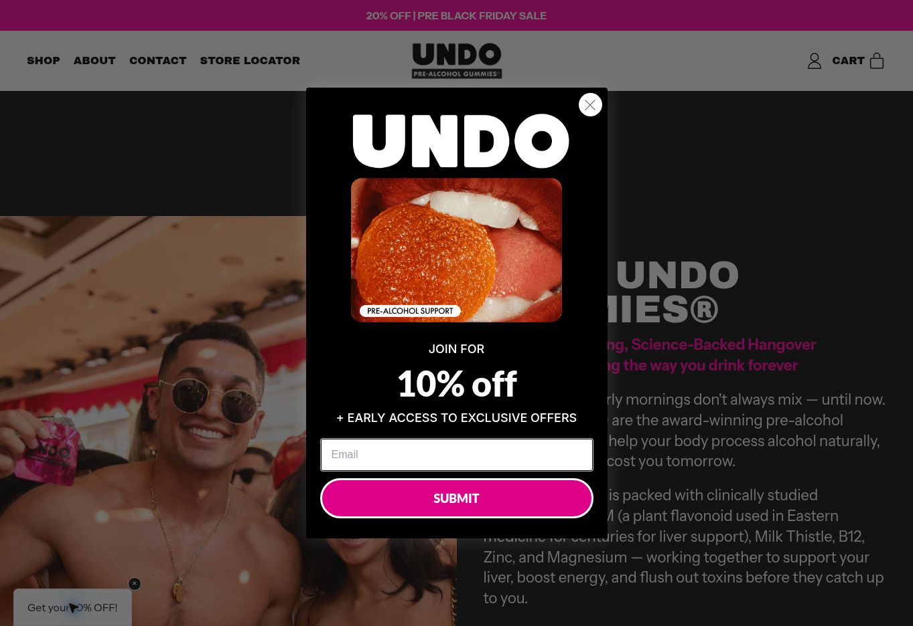
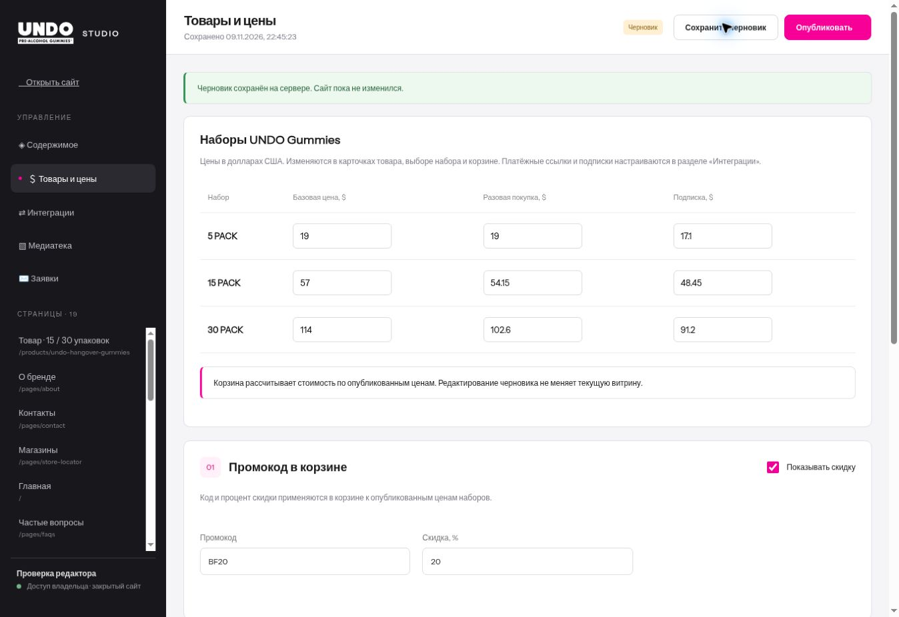
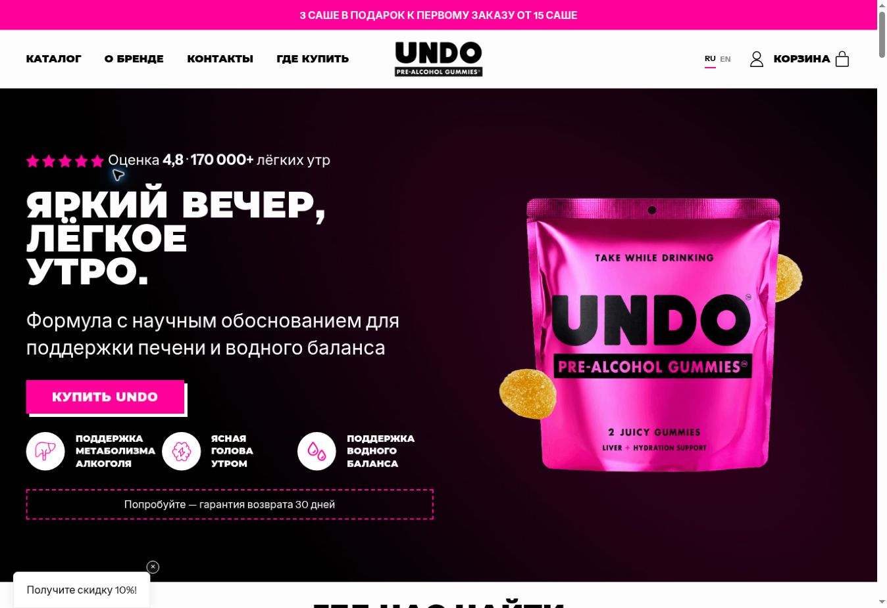

# Проверка локальной копии UNDO

Дата исходного снимка: 9 ноября 2026 года. Текущая версия работает локально: русский язык основной, английский доступен через переключатель **RU / EN**. Публикация и развёртывание на хостинге не выполняются.

## Объём воспроизведения

Первая версия отличалась текстами, FAQ, отзывами, сравнительной таблицей, размерами, порядком секций и навигацией. Приблизительная вёрстка заменена захваченными HTML-структурой и CSS оригинала с локальными ресурсами. Воспроизведены **19 самостоятельных страниц на двух языках**, включая 3 полные статьи блога. Переведены **819 исходных фраз**.

Проверка охватывает структуру страниц и ключевые состояния интерфейса. Контрольные размеры ниже относятся к указанному окну браузера и конкретному состоянию английской версии. Они не доказывают совпадение каждого пикселя на всех экранах; переносы более длинных русских строк требуют отдельной оценки.

| Область | Изменение / свидетельство |
|---|---|
| Главная | Восстановлены исходные 20 основных секций, шапка, подвал, изображения, стили и тексты |
| Геометрия английской версии | При ширине 1363 px начало/высота hero 136/759 px, retailers 896/282 px, science 1178/1040 px совпали с оригиналом в контрольном снимке |
| Языки | 19 русских и 19 английских самостоятельных страниц; переключатель ведёт на соответствующий путь; правки языков независимы |
| Изображения | Исходные фотографии товара сохранены; встроенные английские надписи не перерисованы |
| Слайдеры | Уточнены ширина карточек и интервалы; отзывы зациклены, доступны стрелки и горизонтальная прокрутка |
| Товары | Наборы 5/15/30, разовый и подписной варианты, галерея, увеличение изображения, корзина |
| Галерея | Активная миниатюра подсвечивается и остаётся видимой; реализован touch/pen-жест с порогом и защитой от открытия увеличенного фото после свайпа |
| Окно предложения | В английском контрольном состоянии при окне 1363 × 936 px размер окна предложения — 450 × 674 px |
| Корзина | В том же окне браузера ширина панели — 567.90625 px; восстановлены пустое состояние, группы покупок, подарок, количество, удаление и итог |
| Промо | Редактируемые BF20, скидка 20% и подарок 3-pack стоимостью $15; отдельные переключатели и текст пустой корзины |
| Мобильное меню | Панель открывается слева; мобильная галерея поддерживает переключение жестом |
| Дополнительные URL товара | Адреса внутри коллекций используют тот же контент и историю, что и канонический URL |
| Блог | Три статьи доступны локально, внутренние ссылки ведут между локальными страницами |
| Подключения | Собственные платёжные ссылки, портал подписок, карта iframe/ссылка; по умолчанию выключены |

## Русская версия

Названия элементов приведены к привычным формулировкам: «Каталог», «Где купить», «Личный кабинет», «Доставка по подписке», «жевательный мармелад». Ориентиры для терминологии — официальные сайты [Эвалар](https://shop.evalar.ru/), [Siberian Wellness: подписка](https://ru.siberianhealth.com/ru/shop/subscription/) и [карточка товара Siberian Wellness](https://ru.siberianhealth.com/ru/shop/catalog/product/500563/). Эти источники использованы для языка интерфейса, а не для подмены состава, свойств или изображений UNDO.

Проверка таблиц символов исходных шрифтов через `fontTools.ttLib.TTFont` показала отсутствие кириллицы в Archivo Black и Instrument Sans. Добавлены локальные кириллические шрифты: **Montserrat 900** для заголовков Archivo Black и **Inter** для текста Instrument Sans. Исходные английские шрифты сохранены. Список добавленных файлов находится в `reference/i18n/font-assets.json`.

Цены остаются в USD; курс валют и рублёвые цены не придуманы. Политики и условия переведены с сохранением исходной юрисдикции, компаний, контактов, адреса, сроков и ссылок. Упоминания законодательства США, Европы и Великобритании не заменены законодательством РФ. Словарь политик содержит все 223 исходные строки с точными английскими ключами; URL, email и бренды сверены программно.

## Локальная работа и редактирование

Для запуска нужен Node.js 22 или новее. `start.command` или `start.bat` запускает автономный `local/server.mjs`; обычная работа не требует `npm install`, сборки, облачного аккаунта или облачной базы данных. Админ-панель заранее подготовлена в `public/localadmin/`, общий модуль — в `local/generated/shared.mjs`.

Сервер слушает только `127.0.0.1`, проверяет заголовки Host и Origin для операций записи. Русская и английская версии имеют отдельные документы, черновики и историю. Цены, условия корзины и интеграции общие. Кнопка «Применить к сайту» обновляет только локальную витрину.

Контент, история и заявки хранятся в `data/content.json`, загруженные изображения — в `data/media/`. Сохранение JSON атомарно, устаревшая версия черновика отклоняется. Для переноса или резервного копирования нужно остановить сервер и скопировать всю папку `data`.

## Автоматические проверки

| Набор | Объём и назначение |
|---|---|
| Валидатор CMS | 14 тестов: разрешённые поля и секции, безопасные ссылки, цены, интеграции и настройки корзины, включая старые конфигурации без `cartSettings` |
| Локальный сервер | 12 проверок: loopback и языковые маршруты; независимые RU/EN и черновики; конфликт сохранений; восстановление истории; Host/Origin; загрузка изображений; заявки и повторы; сохранность после перезапуска; блокировка второго процесса для той же папки данных |
| Словарь политик | 223/223 точных ключа, нет пустых или лишних значений; сохранены URL, email и бренды |

Эти проверки подтверждают соответствующие свойства данных и локального сервера. Они не заменяют визуальное сравнение страниц или проверку жестов на физических устройствах.

## Визуальные сценарии и ограничения

В предыдущем контрольном проходе английской версии проверены ввод текста с пробелами, сохранение черновика и применение изменений, замена изображения, выбор 30-pack и разовой оплаты, переключение миниатюр и история версий. В мобильном iframe шириной 390 px содержимое занимало 375 px с учётом полосы прокрутки; горизонтального переполнения документа в том состоянии не было. Эти результаты не следует автоматически переносить на все русские страницы.

**Ключевые мобильные состояния проверены на ширинах 390 и 320 px; итог зафиксирован в конце отчёта.** Обработка touch/pen-жестов реализована в коде, но проверки браузера и iframe не равнозначны испытаниям всех жестов на физических iPhone и Android.

Корзина, маркетинговое окно, окно аккаунта, увеличение фото и служебные сообщения работают на собственном коде. Сторонние скрипты Shopify, персонализация и сервис отзывов не перенесены. Отзывы и промотексты остаются снимком оригинала, а не живыми данными. Платёжные webhook, учёт заказов и синхронизация тарифов не подключены.

## Условия акции и оформление заказа

В заполненной корзине показаны категории покупок, подарок и скидка BF20. Подарок доступен при наличии набора 15 или 30 независимо от разовой покупки или подписки. Он не увеличивает сумму и не передаётся как платная позиция в массиве `{pack,plan,quantity}` для оплаты.

Это отображение условий витрины. Реальная страница оплаты должна повторять скидку и подарок, проверять право на акцию и рассчитывать итог на сервере провайдера. Условие «первый заказ» локальная копия самостоятельно не проверяет. Применение настроек в админ-панели не создаёт акцию у платёжного провайдера.

## Контрольные снимки английской версии

Снимки ниже иллюстрируют предшествующие локализации контрольные состояния. Они не являются подтверждением финальной мобильной проверки RU.

## Финальная локальная проверка

На итоговой сборке проверены RU/EN-переключение, сохранение и применение русского текста без изменения английского, меню на экранах 390 и 320 px, корзина на 390 px и отсутствие её горизонтального переполнения. Исправлены переносы заголовков, ширина языкового переключателя, длина товарных подписей и порядок слов в сравнительной таблице. Физический touch-свайп на отдельном телефоне не проверялся.

Автоматически прошли 14 тестов валидации, 3 теста локализации (включая неизменность URL всех изображений и английских текстовых полей), 12 проверок локального сервера. TypeScript и синтаксис JavaScript проверены.

